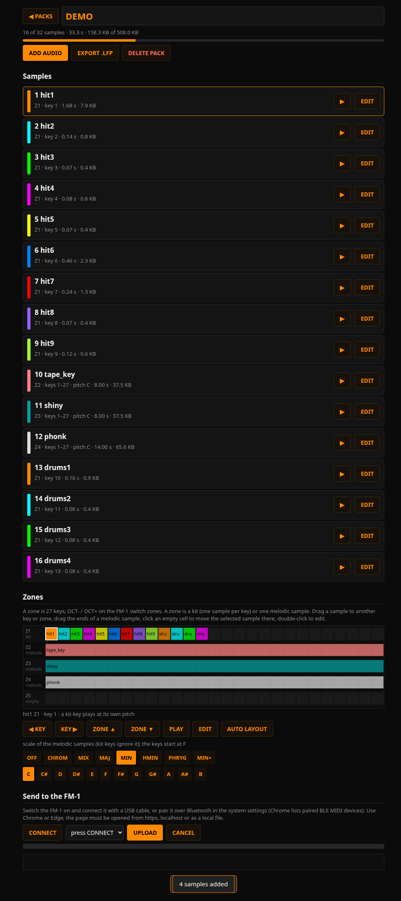
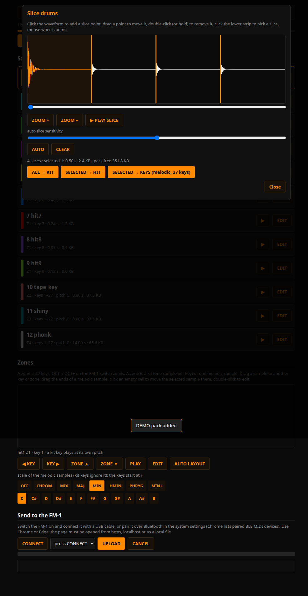
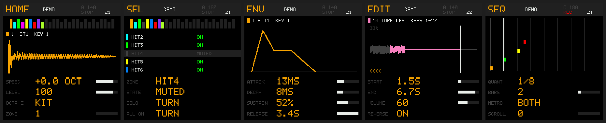
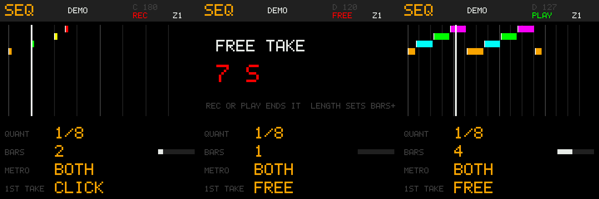
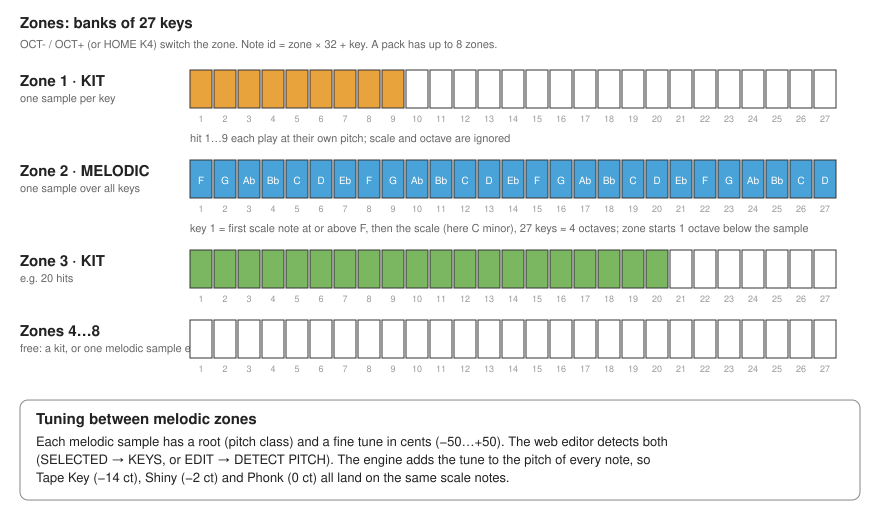

# fm1-lofi

A lo-fi sampler that runs **on the M-VAVE FM-1 itself**, plus a **web editor** (one HTML file) that builds sample packs and sends them over Bluetooth (BLE MIDI) or USB.

* Samples are stored in the FM-1's flash as **16 kHz mono, 2 bit** LMS-ADPCM: about 100 s of audio in the 520 KB the firmware has for a pack.
* The panel is a menu of ten screens (FX, SEL, ENV, LFO, EDIT, GLO, HOME, SAVE, ARP, SEQ), each with four parameters.
* Keyboard zones, scales, per zone envelope / LFO / start / end / reverse, four send effects with punch-ins, an arpeggiator and a live loop sequencer.
* The **web editor** (one HTML file, any Chrome or Edge, Web MIDI) imports audio, slices it, maps it to zones, previews the real 2-bit sound and uploads the pack.

> **Status: v0.9, experimental.** The code is verified on the host (engine tests, upload protocol with packet loss and power-loss injection, a harness that runs the real firmware UI code). It has been tried on a real FM-1 up to v0.6; later versions have **not** been measured on hardware (CPU load, BLE speed, latency). The web editor has not been tried on a real FM-1 over Web MIDI.
>
> **Flashing replaces the firmware of your device.** The flash page embeds the stock V15 image so you can roll back, but you do it at your own risk.

See [docs/STATUS.md](docs/STATUS.md) for the verification matrix, the open risks and the known limitations.

## Screenshots

| Web editor: zones | Web editor: slicer |
|---|---|
|  |  |

Firmware screens (rendered by the host harness): HOME, SEL, ENV, EDIT, SEQ. Sequencer: piano roll, free first take clock, resulting loop.




## How zones work



A zone is a bank of 27 keys, switched with OCT- / OCT+. It is either a kit (one sample per key) or one melodic sample spread over the keys as a scale. Details: [docs/USER_GUIDE.md](docs/USER_GUIDE.md#4-zones-banks-of-27-keys).

## Documents

| File | Content |
|---|---|
| [docs/USER_GUIDE.md](docs/USER_GUIDE.md) | How to use the instrument: panel, every screen, zones, scales, sequencer, uploading a pack |
| [docs/ARCHITECTURE.md](docs/ARCHITECTURE.md) | Hardware limits, repository layout, how the pieces fit, design decisions and why |
| [docs/CODEC.md](docs/CODEC.md) | The 2-bit codec: format, encoder, quality numbers |
| [docs/PACK_FORMAT.md](docs/PACK_FORMAT.md) | The pack image, note ids, zones, flash layout |
| [docs/UPLOAD_PROTOCOL.md](docs/UPLOAD_PROTOCOL.md) | SysEx framing, commands, reliability, power-loss safety |
| [docs/ENGINE.md](docs/ENGINE.md) | The sampler engine: voices, pitch, envelopes, LFO, effects, arpeggiator, sequencer, saved data |
| [docs/FIRMWARE.md](docs/FIRMWARE.md) | The firmware UI code, the screen queue, persistence, build constraints and gotchas |
| [docs/WEB.md](docs/WEB.md) | **The web editor** (replaces the app): usage, modules, tests |
| [docs/BUILD_AND_TEST.md](docs/BUILD_AND_TEST.md) | Every build and test command |
| [docs/STATUS.md](docs/STATUS.md) | Verification matrix, risks, known limitations, ideas |
| [docs/CHANGELOG.md](docs/CHANGELOG.md) | The running log of how the project was built |

## Quick start (host)

```sh
# engine + protocol tests
cd core && for t in test_scale test_zone test_seq test_fx test_defaults; do
  gcc -O1 -DFM1_HOST_TEST -Wno-misleading-indentation -Wno-unused-function -I. -o $t $t.c lofi_engine.c -lm && ./$t | tail -1; done
gcc -O2 -Wno-misleading-indentation -Wno-unused-result -o sim_upload sim_upload.c -lm && ./sim_upload     # upload, packet loss, power-loss sweep
# firmware flash page (JieLi toolchain under wine, see docs/BUILD_AND_TEST.md)
python3 tools/build_fw.py firmware ~/fm1/wine/drive_c/JL/pi32      # -> firmware/build/FM1-Lofi-Workbench.html
```

Screenshots of the firmware screens (rendered by the host harness) are in `docs/img/` (`firmware_pages3.png` = HOME, SEL, ENV, EDIT, SEQ of v0.6).
Built artifacts of every version are in `releases/` (`FM1-Lofi-Editor.html` = the web editor, `FM1-Lofi-Workbench.html` = the flash page of the newest firmware, which embeds the stock V15 for rollback).

## Repository layout

```
core/       portable C shared by firmware, app (JNI) and tests: codec, pack format, upload protocol, sampler engine + tests
firmware/   fork of the FM-1 open firmware (fm1_open via fm1-daw): app/ (our UI, glue), sdk/ (vendor SDK + closed engine library)
web/        the web editor (JavaScript, one self-contained HTML file) + tests
tools/      build_fw.py (wine build), prototype codec, slicer, pitch test
docs/       this documentation
samples/    the source samples used for the tests (Tape Key, Shiny, Phonk, TrapKit)
out/ mp3/ slices/   test renders and listening files
releases/   flash page and web editor (release assets, not committed)
```

## Licence

The firmware is a fork of the GPLv3 FM-1 open firmware (with the SDK linking exception); the vendor SDK/engine library has its own terms (see `firmware/THIRD_PARTY.md`). The SEA-style codec derives from MIT code (Dani Biro; M-VAVE modifications).

## Install

1. **Firmware**: open `FM1-Lofi-Workbench.html` (release asset; Chrome/Edge, Web MIDI/USB) and follow the page. Rollback to stock V15 is on the same page.
2. **Sample packs**: open `FM1-Lofi-Editor.html` (release asset, one file, works offline), import audio, slice, map to zones, CONNECT and UPLOAD over USB or BLE MIDI. See [docs/WEB.md](docs/WEB.md).

## Tests

```sh
# C
cd core && for t in test_scale test_zone test_seq test_fx test_defaults; do gcc -O1 -DFM1_HOST_TEST -w -I. -o $t $t.c lofi_engine.c -lm && ./$t | tail -1; done
# web (node 24)
node web/test/test_codec.js && node web/test/test_pack.js && node web/test/test_pitch.js
```
A CI workflow with the same commands is provided (`docs/ci.yml.example`, copy it to `.github/workflows/ci.yml`). Building the firmware needs the JieLi toolchain under wine (docs/BUILD_AND_TEST.md).

## Contributing and credits

Issues and pull requests are welcome, especially hardware measurements and bug reports from a real FM-1. This project is not affiliated with M-VAVE; "FM-1" identifies the compatible device. Third-party components: [firmware/THIRD_PARTY.md](firmware/THIRD_PARTY.md). The 2-bit codec derives from the MIT-licensed SEA codec.

## Licence

GPL-3.0 ([LICENSE](LICENSE)). `firmware/` is a fork of the GPLv3 FM-1 open firmware with the SDK linking exception ([firmware/LICENSE.md](firmware/LICENSE.md)); the vendor SDK keeps its own terms (firmware/THIRD_PARTY.md). Demo audio: see samples/README.md.
