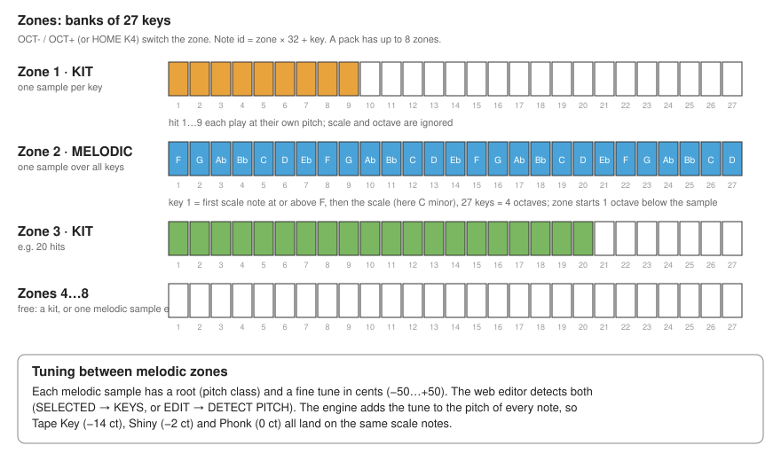

# User guide

## 1. What you need

1. An FM-1 flashed with `releases/FM1-Lofi-Workbench.html` (open it in a Web-MIDI browser; the page embeds the stock V15 firmware, so you can go back).
2. A computer or phone with Chrome or Edge to run the web editor (`FM1-Lofi-Editor.html`; Bluetooth LE MIDI or a USB cable to the FM-1).
3. Samples: any audio file the browser can decode (wav, mp3, flac, ogg, aac). The editor ships a DEMO pack (TrapKit hits, Tape Key, Shiny, Phonk bass) so you can start without any files.

## 2. The panel

```
 OCT-  OCT+  FX   SEL  ENV  LFO  EDIT  GLO  HOME  SAVE  ARP  SEQ  PLAY  REC     buttons 0..13
 encoders: SELECT  ALG  K1  K2  K3  K4  PRESETS       (PRESETS is not used)
 27 keys F3 .. G5                                       (key 1 = F)
 MASTER knob = output level
```

* **Every button of FX .. SEQ is a screen with four parameters.** The four parameters are always K1, K2, K3, K4 (the four encoders after ALG).
  The button of the open screen is lit and all the others are dark. Pressing the same button again returns to **HOME**.
* **SELECT** picks something on the screen: the active sample (most screens), the effect (FX), the pattern (SAVE, SEQ), on/off (ARP).
* **OCT- / OCT+** switch the **zone** (see 4).
* **PLAY / REC** are transport buttons and light with the transport.
* **Keys that sound blink off.** The filled keys of a zone are lit; a key whose sample is sounding goes **dark** while it plays (held keys, notes of the sequencer, the arpeggiator and MIDI alike) and the key on the screen strip is drawn tall and white. (The LEDs are single colour on/off, so the sounding state is shown by flipping the lit key.)
* The header of every screen shows: screen name, pack name, `A 140` = selected pattern and BPM, the transport state (STOP / COUNT / PLAY / REC), `Zn` = current zone, and `*` when settings or loops changed since the last SAVE.
* The four tiles at the bottom show name, value and a bar for K1..K4. A few tiles are actions (SAVE, SOLO, ...) and show `TURN`: one click to the right does it.

## 3. Samples, kits and melodic samples

A **pack** (what you upload) holds up to 32 **samples** (the app calls them slots). One sample is either

* a **kit hit**: it sits on one key and plays at its own pitch (drums, one shots; by default one-shot: the key release does not stop it), or
* a **melodic sample**: it is spread over the keys of a zone and played as a scale.

## 4. Zones (banks of 27 keys)



* A zone is the whole keyboard of 27 keys. **OCT- / OCT+** (or HOME K4) switch to the previous / next zone. A pack has up to 8 zones.
* A zone is **either a kit** (up to 27 samples, one per key) **or one melodic sample**. Keys that have a sample are lit, empty keys are dark.
* **Melodic zones:** key 1 (F) is the first note of the scale at or above F (in C minor: F), then the next notes of the scale, 27 keys in all (about 4 octaves in a seven note scale).
  The zone starts **one octave below** the sample's pitch; on HOME **K3 OCTAVE** moves the whole zone by octaves (-3 .. +3). No scale selected = the keys are chromatic from F.
* **Kit zones** ignore the scale and the octave.
* Pitch goes up to 8x the speed of the stored 16 kHz sample (three octaves above the sample), down to 1/16x (four octaves below). Keys beyond that would sound the same, so the app places samples so that the 27 keys stay inside.

## 5. The screens

### HOME
The 27-key strip coloured by sample (muted samples are grey, held keys are tall and white), the name and key of the active sample and its **waveform** (computed in the background, a percentage shows while it is analysed).

| Tile | Meaning |
|---|---|
| K1 SPEED | **live playback speed**, from -4 to +1 octave, applies to sounding voices at once |
| K2 LEVEL | master level of the sampler (0-127) |
| K3 OCTAVE | base octave of the melodic sample of this zone (`KIT` in a kit zone) |
| K4 ZONE | current zone (same as OCT- / OCT+) |

Pressing a key also makes its sample the **active sample**: ENV, LFO, EDIT and the sends then edit that sample.

### FX
SELECT picks the effect: **REVERB, DELAY, CRUSH, FILTER**. They are **send effects**: each sample has its own send amount to each effect (tile K4 SEND, for the active sample; the **ALG** encoder changes the active sample without leaving FX).

| Effect | K1 | K2 | K3 | K4 |
|---|---|---|---|---|
| REVERB | SIZE (feedback) | DAMP (high cut in the tail) | RETURN level | SEND of the active sample |
| DELAY | TIME (1/16, 1/8, 3/16, 1/4, 3/8, 1/2, 3/4, "1 BEAT" = a whole note; tempo synced, at most about 1 s) | FEEDBACK | TONE (low pass in the feedback) | SEND |
| CRUSH | BITS 2-16 | RATE (sample and hold 1-32) | RETURN level | SEND |
| FILTER | CUTOFF 40 Hz-10 kHz | RESO | TYPE low / high / band pass | SEND |

**On this screen the keys are punch-in effects** (momentary, key up = effect off), keys 1..12:
`REV` reverb throw, `DLY` delay throw, `CRU` heavy bit crush, `DWN` down-sample, `LPF` low pass (closes the sound), `HPF` high pass,
`ST8` / `S16` stutter gates at 1/8 and 1/16, `STU` stutter (beat repeat): the first 1/16 note after the press passes through and is recorded, then it loops until you release the key; ST8 / S16 are rhythmic gates, `HLF` half speed, `DBL` double speed, `STP` tape stop (slows down and fades while held, comes back on release).
Their keys are lit.

### SEL
The keys are **mute switches** of the samples on them (a lit key = audible, dark = muted). SELECT / K1 pick a sample; K2 STATE mutes (turn right) / unmutes (left); K3 SOLO (right: mute all others, left: unmute all); K4 ALL ON.

### ENV
Amplitude envelope of the active sample, with the curve drawn. **K1 ATTACK, K2 DECAY, K3 SUSTAIN (%), K4 RELEASE.** Times run from 1 ms to 4 s (exponential). Defaults: attack 1 ms, decay 66 ms to sustain 100 %, **release about 1 s**.
Kit hits are one-shot (play to the end, ignore the key release).

### LFO
**K1 RATE** (0.1-25 Hz), **K2 DEPTH**, **K3 SHAPE** (sine / triangle / square / saw), **K4 TARGET**: pitch (vibrato, up to +-12 semitones at full depth), volume (tremolo) or pan.

### EDIT
Waveform with the start and end markers. **K1 START, K2 END** (shown in ms of the sample), **K3 VOLUME** of the sample (100 = unity), **K4 REVERSE** (on / off; plays the selected region backwards).

### GLO (global)
**K1 BPM** (40-240), **K2 MEASURE** (beats per bar 2-7, shown as `n/4`; changing it clears all patterns and only works with the transport stopped), **K3 ROOT** (root of the scale), **K4 SCALE** (OFF, CHROM, MIX, MAJ, MIN, HMIN, PHRYG, MIN+).
The picture shows the scale on a 12-note keyboard and the beats of the bar. Defaults: **140 BPM, C minor (MIN, root C)**.

### SAVE
**The 8 keys 1..8 are the patterns A..H** (selects the pattern; a lit key has recorded notes). SELECT also picks the pattern.
Tiles are actions (turn right to do): **K1 SAVE** writes the loops and all settings to the flash, **K2 CLR PAT** clears the selected pattern, **K3 CLR ALL** clears all patterns, **K4 COPY TO** copies the selected pattern to the next one.
Nothing about envelopes, LFOs, effects, mutes, start/end ... survives a power off unless you SAVE (the `*` in the header shows unsaved changes).

### ARP
SELECT turns the arpeggiator **ON / OFF**. **K1 RATE** (1/4, 1/8, 1/16, 1/32), **K2 DIRECTION** (up, down, up-down, random), **K3 RANGE** (1-4 octaves; an octave is the number of notes of the scale), **K4 GATE** (5-100 %).
Hold keys (up to 8) and the notes are played one after the other, in time with the BPM. The arpeggiated notes are what is recorded by REC. It works on melodic zones; on kit keys it plays the held keys in turn.

### SEQ
A **piano roll** of the selected pattern: time across, one row per note, bars coloured by sample, a white playhead.
**K1 QUANT** (OFF, 1/8, 1/16, 1/32 - recorded note starts snap to the grid), **K2 BARS** (pattern length 1, 2, 4, 8 bars), **K3 METRO** (OFF, CLICK = click while recording, COUNT = one bar count-in before recording, BOTH), **K4** reserved. SELECT picks the pattern A..H.

## 6. Recording a loop

1. Choose the pattern (SAVE or SEQ screen), the length (SEQ K2) and the BPM (GLO K1).
2. Press **REC**. With the count-in on you hear one bar of clicks, then recording starts at the beginning of the pattern. (The metronome clicks only while recording, never during plain playback.)
3. Play. Everything is quantised and recorded; the loop repeats and **keeps adding** (overdub). A new pass never plays back what you are playing in that very pass.
4. Press **REC** again or **PLAY** while recording: recording stops, **playback goes on**. PLAY with the transport running and not recording stops it; PLAY while stopped starts it.
5. There is **no undo button** in this version (the ARP button is the arpeggiator screen now). Clear the pattern on the SAVE screen (K2) and record again. The engine has an undo of the last pass (`le_seq_undo`) that is not wired to a control yet.
6. **All patterns run on one shared clock**: switching pattern while playing continues at the same point of the beat; patterns of different lengths stay in step (a 1-bar pattern repeats inside a 2-bar one).
7. SAVE (K1) to keep it.

## 7. MIDI

BLE MIDI is on at power-up (the FM-1 is a peripheral). From a MIDI keyboard or a DAW: **notes 0-127 play the note ids directly** (note n = zone n/32, key n%32, so zones 1-4 = notes 0-127), **pitch bend** +-2 semitones, **CC 20 = live speed** (0..127 = -4..+1 octave). With the arpeggiator on, MIDI notes go through it too.

## 8. Uploading a pack (web editor)

The **web editor** (`releases/FM1-Lofi-Editor.html`, see WEB.md) does the same as the steps below from Chrome / Edge on a computer or phone: CONNECT, pick the FM-1, UPLOAD.


1. Open the app, make or open a pack (the DEMO pack is there on the first start). The pack screen shows how full the pack is.
2. **UPLOAD** → the app lists USB MIDI devices and scans for Bluetooth LE MIDI devices (grant the Bluetooth / location permission). Tap the FM-1.
3. The FM-1 shows **UPLOAD nn %**; the editor shows the progress. A pack of 160 KB is about 1250 blocks; lost blocks are re-sent automatically.
4. When it is done the FM-1 returns to HOME with the new pack. Uploading **replaces** the pack on the device, and the loops/settings belong to a pack: a different pack starts with default settings and empty patterns. If the connection drops during an upload the FM-1 is left with **no pack** (never a half pack); just upload again.

See [WEB.md](WEB.md) for the editor.

## 9. Defaults at a glance

BPM 140 · scale C minor · zone octave -1 for melodic zones · release about 1 s · quantise 1/16 · pattern length 2 bars, 4 beats a bar · metronome click on while recording, count-in on · 8 patterns × 160 events · punch-ins on the first 12 keys of FX.


## Free first take (v0.9)
SEQ page, K4 `1ST TAKE`: FREE (the default) or CLICK (count-in + metronome, the tempo is set first). With FREE press REC (blinking), play whenever you want: the clock starts with the first key. Press REC or PLAY to end: the length of the take is rounded to 1, 2, 4 or 8 bars and the tempo is calculated from it, then the loop plays.

## Tuning melodic samples (v0.9)
In the web editor SELECTED -> KEYS finds the pitch of the sample and its offset in cents; EDIT shows both (fine tune, DETECT PITCH). All melodic zones then play in tune with each other.
